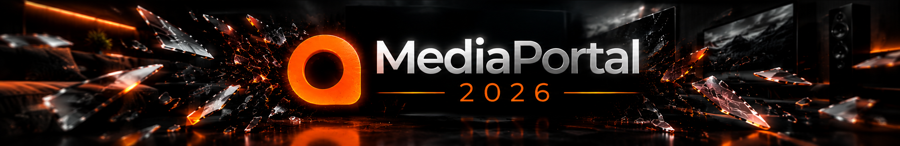

<div align="center">



**A media centre for the whole household: one server that answers over HTTP, one 10-foot screen
that wears a skin, and a television that comes from TVHeadend instead of a Windows service.**

[](https://dotnet.microsoft.com/)


*Every chapter of this documentation is also one of GitHub's own tabs above the file list: **README**
is this page, **Security** is [Architecture](SECURITY.md), **Accessibility** is the
[Manual](ACCESSIBILITY.md), and **License** is the [licence](Licence.md). That row shows six
pages at most - README, Contributing, Code of conduct, the licence, Security and Accessibility - and
GitHub writes the labels itself, so a chapter borrows the nearest free name rather than staying out of
the row. `SUPPORT.md`, which is where a manual would sensibly go, is not one of the six: GitHub reads
it when somebody opens an issue and shows no tab for it.*

</div>

---

## What this tree is

MediaPortal 2 began as a Windows media centre: one process on one TV, DirectShow for pictures,
MP2's own TV service for live television, WPF for the interface. This branch turns it into
something that runs anywhere without throwing the library, the metadata or the skins away.

Three decisions carry that:

- **The server was made portable and headless.** It is a `net10.0` console host that answers a
  documented HTTP/JSON API on one port, keeps its library in SQLite, and runs on Windows and on
  Linux in a container. There is no window, no tray icon and no configuration tool on a server.
- **The screen was rewritten in Avalonia.** `MediaPortal.Frontend` is a `net10.0` assembly - never
  `net10.0-windows`, with `CA1416` as an error - that talks to the server over HTTP and to nothing
  else. It draws the old MPF skins from their own XAML files on disk.
- **Live television stopped being MediaPortal's job.** The TV service layer (TVE 3/3.5, TvMosaic,
  and the x86 pin that came with it) is deleted. The front end speaks
  [TVHeadend's JSON API](https://tvheadend.org/) directly: channels, grid, timers, recordings.

Nothing above the HTTP seam references a MediaPortal assembly, and that rule is held by the build
rather than by convention - see
[Architecture](SECURITY.md#the-rule-that-holds-the-rest-up).

## Where it stands

Measured, not remembered. The wide numbers come from the roadmap's status table
([`docs/multiplatform/ROADMAP.md`](docs/multiplatform/ROADMAP.md), *Where the tree stands*); the
front-end test count was counted on this branch.

| | |
|---|---|
| Portable core assemblies | **4 of 90** - the rest are still `*-windows`, and each one is a porting task of its own |
| Platform-not-supported warnings (`CA1416`) | **0** in every gated solution |
| Front-end unit tests | **1250 passing**, with no display and no hardware needed |
| Server | builds, starts and answers HTTP on **Windows and Linux** |
| Skins the front end can wear | **default**, **Nereus**, **WMC** |
| Screens in the front end | 34, from the wake screen to the DVR list |
| Old skins left in the tree | only **Nereus** and **WMC**, on purpose |

## What works today

**The server** - a SQLite library whose metadata comes from the files and from NFO, thumbnails and
fanart served as pictures, HTTP streaming of the media itself, playback reports and watched states,
user profiles with a PIN and an age ceiling, shares and folders an import can walk, a long-lived
media-events channel a screen listens to, settings for the server and for its plugins, tokens from
an OAuth-style password grant, and UPnP/SSDP announcements so a television can find it.

**The screen** - a wall of covers that grows as it is walked, the main menu as tiles, a programme
guide with a real grid, live TV and radio, a player with a skip ladder and subtitles, a picture
slideshow with Ken Burns, weather and news, a party mode that shuffles the music, a wake screen
that asks who is watching, an on-screen keyboard, and a key-binding file so a real remote can be
fitted without recompiling anything.

**The player** - libVLC, found at run time on whichever machine it is installed on. It replaced
DirectShow, which was the last thing keeping the front end on Windows.

## What is gone, and why

| Gone | Why |
|---|---|
| MP2's TV service (TVE 3/3.5, TvMosaic, `Gentle`) | live TV now comes from TVHeadend, which exists everywhere; 54 files and 6833 lines went, and the x86 pin with them |
| DirectShow and `EVRPresenter` | libVLC plays what DirectShow did, and does it portably |
| BlueVision, Titanium Extended, and the Graveyard skins | only Nereus and WMC are worth reading after the Avalonia rewrite |
| `.NET Framework 4.8` targets and `x86` | the tree is `.NET 10` and x64; `architecture.ps1` fails a build that reintroduces either |
| The Windows configuration tool | every setting it held now has a screen, a file, or an endpoint |

What did **not** go: the library and its metadata, the shares, the user model, the media events,
the picture caching, and the two skins that carry the look of the old front end.

## Try it in three commands

From the repository root, on Windows, with the .NET 10 SDK installed:

```powershell
# 1 - publish the server into a runnable layout and start it on port 55555
.\scripts\ci\deploy-server-layout.ps1
dotnet .\build\artifacts\server-layout\MP2-Server-Headless.dll --data .\build\artifacts\mp2-live\data

# 2 - build the front end
.\scripts\ci\build.ps1 -Solution Frontend

# 3 - put it on the screen, wearing the Nereus skin
.\MediaPortal\Source\Frontend\MediaPortal.Frontend\bin\Debug\net10.0\MediaPortal.Frontend.exe `
  --server http://127.0.0.1:55555/MediaPortal/Server --theme nereus
```

While the server runs, `http://127.0.0.1:55555/MediaPortal/Server/health` answers.
Step by step - with a keyboard reference, a screen index and a troubleshooting table - is the
[Manual](ACCESSIBILITY.md). How the pieces fit is [Architecture](SECURITY.md).

## Where things live

| | |
|---|---|
| `MediaPortal/Source/MP2-Server.sln` | the portable server: core, backend, plugins, `Server.Api`, the headless host |
| `MediaPortal/Source/MP2-Frontend.sln` | the Avalonia front end, its player, its tests, and the five core assemblies it borrows |
| `MediaPortal/Source/MP2-Client.sln` | the old WinForms client - it still builds, and it is not the way forward |
| `.../MediaPortal.Frontend/Skins/Nereus` | the ported reference skin, as XAML on disk |
| `MediaPortal/Source/Main/MediaPortal.Server.Headless` | the console host that runs the server |
| `scripts/ci/` | every build, gate and test the tree is checked with; `scripts/ci/README.md` is their manual |
| `docs/multiplatform/` | the assessment, the proposals, the roadmap, and rendered frames of the screens |

## Read on

- **[Architecture](SECURITY.md)** - the processes, the HTTP seam, the skin engine, the
  portability spine, and the gates that keep them that way.
- **[Manual](ACCESSIBILITY.md)** - build it, run it, point it at a server, bind a remote, and set up
  TVHeadend, weather and news.
- **[`scripts/ci/README.md`](scripts/ci/README.md)** - the long story of every gate: what it
  measures, what it was calibrated on, and what it fails on.
- **[`docs/multiplatform/ROADMAP.md`](docs/multiplatform/ROADMAP.md)** - the phases, in order, each
  with what it proved.

## Licence and credit

MediaPortal 2 is **GPL-3.0** (or, at your option, any later version), as each source file's header
states; the text itself is in [`Licence.md`](Licence.md). Two pieces inside it carry their own terms:
the vendored `LiquidGlassAvaloniaUI` control is **MIT**, and the player's managed libVLC binding
(`LibVLCSharp`) is **MPL-2.0**; libVLC itself is not vendored and is found at run time.

The original MediaPortal 2 was built by [Team MediaPortal](https://www.team-mediaportal.com/) -
[upstream repository](https://github.com/MediaPortal/MediaPortal-2),
[support forum](https://forum.team-mediaportal.com/categories/mediaportal-2.528/). The old wiki and
the Redmine tracker are closed; the roadmap this branch follows lives in `docs/multiplatform/`
instead.
