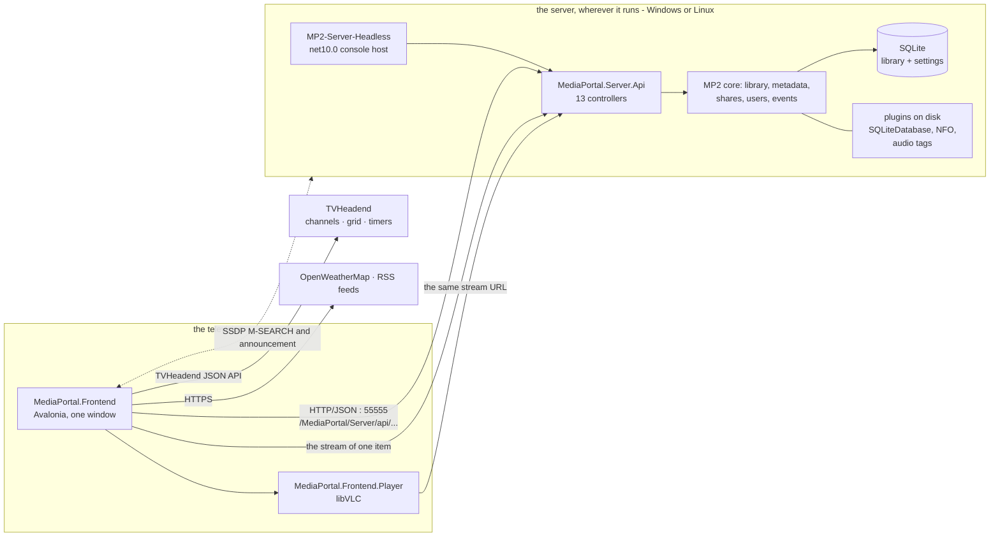
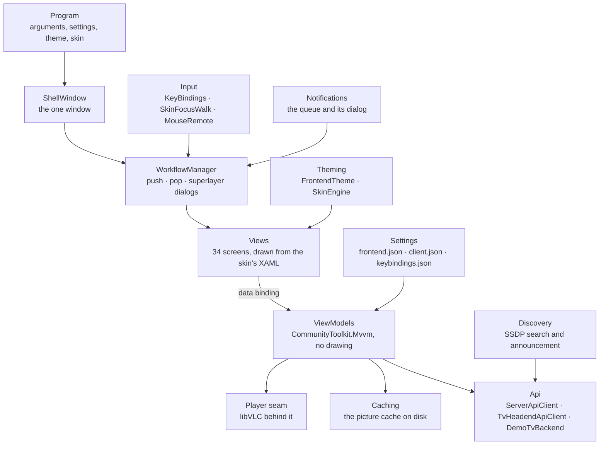
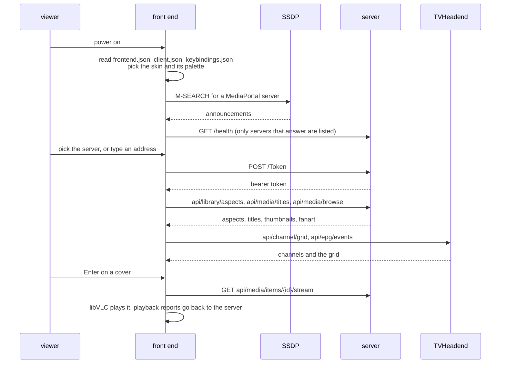
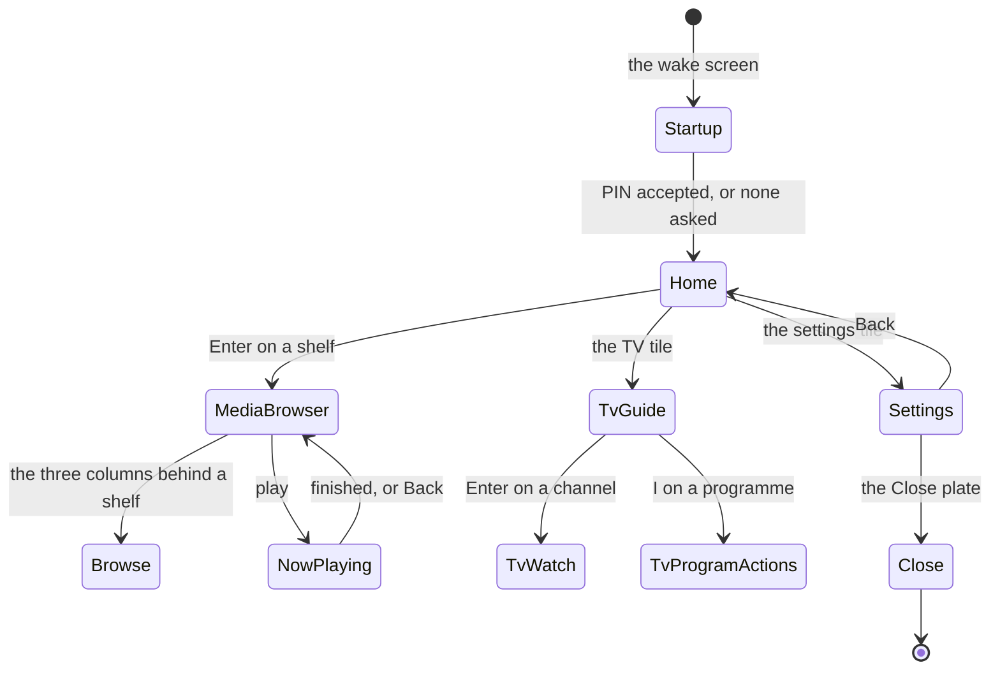
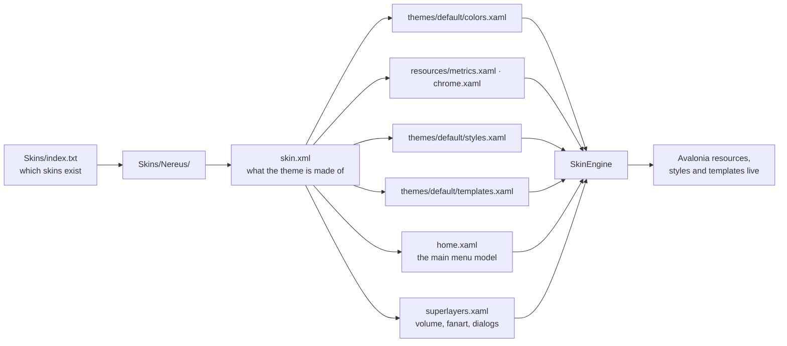
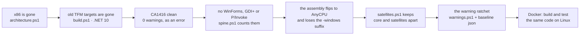

# Architecture

**Two processes, one HTTP seam, and a rule that keeps them apart.**

<table>
<tr>
<td align="center"></td>
<td align="center"></td>
<td align="center"></td>
</tr>
</table>

*Without images: [General](../ReadMe.md) · **Architecture** · [Manual](Manual.md)*

---

## The shape of it

One machine runs a server; every television in the house runs a front end. They know each other only
through HTTP, and the front end finds the server on its own.

Three things follow from this picture and are worth saying plainly:

- **Live TV never touches the MediaPortal server.** The front end asks TVHeadend itself. Recording
  schedules are TVHeadend timers, and the guide is TVHeadend's EPG.
- **The picture is drawn by libVLC into a handle the front end hands down**, while everything above
  the player seam speaks only `PlayerState`, `MediaOpened` and `PlaybackSession`.
- **The dashed line is the only magic.** The front end sends an SSDP `M-SEARCH`, listens for the
  server's announcement, and lists a server only after its HTTP API has actually answered - a device
  that answers SSDP and not HTTP is not offered to the viewer.

## The rule that holds the rest up

`MediaPortal.Frontend.csproj` states it, and the build enforces all four clauses:

1. **`net10.0`, never `net10.0-windows`, with `CA1416` as an error.** A platform-not-supported
   warning fails the build rather than being counted.
2. **No MP2 project references.** The only two projects the front end references are its own player
   and the vendored glass control. The five core assemblies that sit beside it in
   `MP2-Frontend.sln` (`Server.Api`, `Common`, `Utilities`, `UPnP`, `Backend`) are in the solution so
   that the HTTP contract can be built, tested and gated together with the thing that consumes it -
   the executable itself links against neither MP2 nor any Windows-only code.
3. **MVVM with `CommunityToolkit.Mvvm`.** View models hold the decisions; views hold only drawing.
   That is what makes 1250 tests possible with no display: the tests drive the view models.
4. **Skins are loose files.** XAML, images, fonts and sounds are copied next to the executable and
   read from disk at start-up. An edit that is built is an edit that is seen.

The payoff: the same assembly that runs on this Windows desktop is built and unit-tested headless in
a Linux container.

## The server

| | |
|---|---|
| Host | `MediaPortal/Source/Main/MediaPortal.Server.Headless` → `MP2-Server-Headless.dll` |
| Run it | `dotnet MP2-Server-Headless.dll --data <folder>` (`--check` answers once and exits, `--duration <sec>` holds the port for a script) |
| Address | port **55555**, path base **`/MediaPortal/Server`**, health at `GET /MediaPortal/Server/health` |
| Storage | SQLite, plus plugins dropped into `Plugins\<Name>\` by `scripts/ci/deploy-server-layout.ps1` |
| Auth | `POST /Token` with an OAuth password grant; every `api/...` call then carries a bearer token |

What the API offers, controller by controller:

| Controller | What a screen gets from it |
|---|---|
| `Token` | the bearer token everything else needs |
| `Session` | the logged-in session, and its goodbye on exit |
| `Users` | the household: names, PINs, pictures, age ceilings |
| `ServerInfo` | what server this is, for the connection and status screens |
| `Library` | the aspects (`MovieItem`, `TvEpisodeItem`, `MusicAudioItem`, …) and their counts |
| `Media` | titles, groups, one item, its thumbnail and fanart, its stream, playback reports, fanart warming |
| `Browse` | the three columns a shelf is browsed through |
| `MediaEvents` | the long-lived channel the server tells the screen things on |
| `Shares` | the folders the library is built from, and the import that fills it |
| `Settings`, `MetadataSettings`, `PluginSettings` | the server's, the extractors' and the plugins' own settings |
| `NetworkCredentials` | the credentials a share on somebody's SMB box needs |

Everything the front end shows about the library arrives through these endpoints, and the gate
`scripts/ci/run-server-check.ps1` asserts exactly that: state change, store opened, endpoints
reachable, and the three answers an unauthenticated caller must get (`403`,
`unsupported_grant_type`, `invalid_grant`).

## The front end

One window, and a stack of frames behind it.

Three of those boxes are worth a word:

- **The workflow, not the window.** A screen is a frame, not a window. Back pops one frame; a dialog
  is a frame laid over the stack as a superlayer. That is why `Escape` behaves correctly on a
  keyboard-only device and why nothing in the front end needs a window manager.
- **Focus walks the way the skin drew it.** `SkinFocusWalk` moves focus by geometry rather than by
  tab order, because on a wall of covers the only honest map of "the next one to the right" is the
  position the skin chose.
- **The picture cache.** Covers and fanart are pulled once, written to a folder the media settings
  screen names, capped by size, and read from there afterwards. A television should not re-download
  a poster every time a shelf is walked.

## A start-up, in order

The front end works with **no server at all** until one is needed: the wake screen, the clock, the
settings screens, the on-screen keyboard and `--play <file>` all run before anything answers.

## The screen stack

`I` opens what a title is, `F` moves to a search field, `W` rounds through the watched states, `V`
changes the view, `M` is the media key, `F16` is the menu key; the arrows and `Enter` belong to the
screen that has them. The full list, and how to rebind any of it, is in the
[Manual](Manual.md#the-keys).

## The skin engine

The reference skin is not compiled into the front end. It is a folder, and this is what reading it
looks like:

- **`SkinEngine` reads the folder beside the executable first** and falls back to the copy indexed
  inside the assembly. `MP2_SKINS_DIR=<folder>` points at skins kept somewhere else, and the start-up
  log says which of the two copies ended up on screen. A named folder that is missing is said out
  loud rather than quietly skipped.
- **`home.xaml` is the menu model, not a layout.** The reference skin drove its main menu from a
  model of shelves, tiles and targets; that model is what the front end parses, which is why the
  tiles, their order and their screens are skin content and not code. `NereusMenuEditView` is the
  editor for it.
- **A palette is a name, not a build.** `default`, `nereus` and `wmc` are chosen with `--theme`,
  `MP2_THEME`, or the front end's own theme screen, and an unknown name is announced before the
  familiar colours come back.
- **The skin carries its own settings** - transparency, cover details, auto-scroll, fanart blur and
  overlay opacity, clock and weather on the shelf - and the skin settings screen shows only the
  switches the worn skin actually declares.

Two facts about Avalonia cost a day each and belong in the record: a `TemplatedControl` overrides
`ClipToBounds` to `true`, so a shadow drawn by an item's own template is clipped unless the item
says otherwise; and a `Border` draws its `BoxShadow` inside its own `DrawRectangle`, so a corner
radius on the border that carries a shadow round-clips the shadow it is casting. Shadows therefore
live on a border that has no radius, and edges live on a border above the tile - never on the tile's
own border, where two different corner circles meet and produce an arc in the corner.

## The player seam

| | |
|---|---|
| Assembly | `MediaPortal/Source/Frontend/MediaPortal.Frontend.Player` |
| Underneath | libVLC through the official VideoLAN binding (`LibVLCSharp`, MPL-2.0) |
| Above it | `PlayerState`, `MediaOpened`, `PlaybackSession` - not one LibVLCSharp type crosses |
| libVLC itself | **not vendored, not downloaded**; `NativeLibraryLocator` finds the installation on the machine |
| Replaces | DirectShow, which is why the front end can be `net10.0` |
| It is not | a TV service - it plays a stream URL and reports position |

`--play <file> [sec]`, `--start <time>` and `--shot <file>` exist because of this seam: a film can be
played, and the frame the screen drew can be saved as a PNG, without a server, a library or a click.

## The portability spine

The tree is 157 projects, most of them still Windows-only. Rather than pretend otherwise, the branch
counts what is portable and refuses to let the count go backwards.

- **`spine.ps1`** counts WinForms, GDI+ and P/Invoke uses against `spine-baseline.json`; the core
  target is zero, and the rule covers core and satellites together so the count cannot be moved from
  one to the other.
- **`warnings.ps1`** ratchets findings per solution against `warning-baseline*.json`. The front end's
  floor is 237 findings, all of them inherited from NuGet analyser packages - the front end's own
  code contributes zero.
- **The five Linux containers** (`server`, `canary`, `cross`, `frontend`, `drawing` - one
  `Dockerfile.*` each) prove the portable halves build and run there, and the front end's UI tests
  run with no display at all.

Current state: **4 of 90** core assemblies portable, `CA1416` at 0/0 in every gated solution, and
the server answering HTTP on Windows and Linux. Each portable assembly is a decision of its own,
documented in `scripts/ci/README.md`.

## The gates, in the order they run

| Gate | What it would catch |
|---|---|
| `build.ps1 -Solution Server,Frontend,Client -Ratchet` | anything that does not compile, and any warning above the floor |
| `warnings.ps1` | a new warning in a solution that had stopped growing |
| `spine.ps1`, `satellites.ps1`, `packages.ps1` | Windows-only code or a Windows-only package creeping into the portable half |
| `tests.ps1` | the five Windows suites, front end included |
| `run-server-check.ps1` | a server that starts but answers nothing |
| `test-server-upnp.ps1` | an announcement that lies, so discovery would offer a dead address |
| `test-frontend-check.ps1` | a front end that cannot read a live server - and four screens that no longer render |
| `test-frontend-discovery.ps1` | SSDP that stopped working |
| `architecture.ps1` | an x86 declaration or a non-x64 executable coming back |
| `docker` canaries and `test-*-linux.ps1` | any of the above failing once Windows is not in the room |

`scripts/ci/README.md` explains each one - what it measures, what it was calibrated on, and the
reason it exists.

## Background reading

| Document | What it settles |
|---|---|
| [`docs/multiplatform/Multiplatform-Assessment-and-Plan.md`](multiplatform/Multiplatform-Assessment-and-Plan.md) | the census of the tree and the order the porting happens in |
| [`docs/multiplatform/SkinEngine-Multiplatform-Proposal.md`](multiplatform/SkinEngine-Multiplatform-Proposal.md) | how the MPF skins could be worn without WPF |
| [`docs/multiplatform/P2-New-Frontend-on-Ported-Backend-Plan.md`](multiplatform/P2-New-Frontend-on-Ported-Backend-Plan.md) | the front end as a client of the ported backend |
| [`docs/multiplatform/New-Media-Center-Feasibility-and-Blueprint.md`](multiplatform/New-Media-Center-Feasibility-and-Blueprint.md) | what a new media centre would need, and what this one already has |
| [`docs/multiplatform/ROADMAP.md`](multiplatform/ROADMAP.md) | the phases in order, each with its proof |
| [`scripts/ci/README.md`](../scripts/ci/README.md) | every gate, in the detail |

Frames rendered headlessly by `Frontend.RenderProbe`, as the gates write them:
[`docs/multiplatform/screenshots/`](multiplatform/screenshots/).
